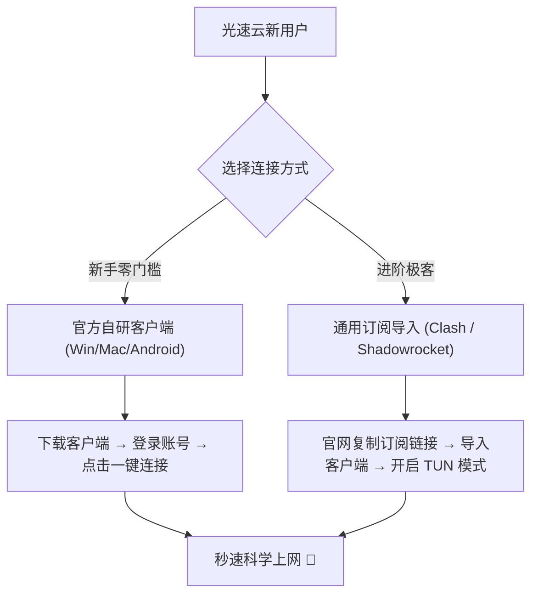

# 光速云深度评测：2026 稳定梯子第一主推 · IEPL 双专线与永久套餐实测

<StickyNote title="极客学妹核心评测导读" emoji="🌸">
  <b>光速云（Guangsu Cloud）</b>是赔钱博客在 2026 年度 42 家机场评测中列为<b>第一主力推荐</b>的品牌。它自 2020 年起稳定运营至今，采用行业少有的 <b>IEPL 物理专线 + 企业级内网专线双重物理架构</b>，全节点严格按 1 倍率计费。对于轻度用户，其独创的 <b>147 元 247GB 永久不过期套餐</b>是告别每年清空流量的绝佳选择；对于重度办公和追剧用户，其实测 <b>529Mbps / 22ms 延迟</b>的香港节点表现亮眼。
</StickyNote>

  

    
<strong>光速云 综合核心参数与实验室核验状态</strong>

    
● Operational / 实验室已核验

  

  

    
<b>运营年份：</b>2020 年至今（运营超 5 年）

    
<b>线路架构：</b>IEPL 专线 + 企业内网专线

    
<b>核心协议：</b>VLESS 现代抗封锁协议

    
<b>入门价格：</b>年付折合约 ¥8/月（¥99/年）

    
<b>优惠码：</b><code>AMM</code>（享新人折扣）

    
<b>设备限制：</b>完全不限设备数量

    
<b>流媒体支持：</b>Netflix、Disney+、HBO、TikTok 原生

    
<b>AI 工具支持：</b>ChatGPT、Claude 原生，Gemini 视节点

  

  

    <a href="https://sahude.gsyvipaff.com/#/?code=keqgvT5Y" target="_blank" rel="nofollow sponsored noopener" class="sakura-btn-cta">
      🚀 立即前往光速云官网体验（优惠码 AMM）
    </a>
  

---

## 一、品牌背景与底层专线架构拆解

在评估一家机场是否具备长期可靠性时，**运营年限** 与 **物理网络链路拓扑** 是最重要的两项底层指标。

### 1. 五年老牌的抗风险能力
光速云开业于 2020 年，经历过数次重大会议周期的公网防火墙升级与国际出口风暴。与那些几个月换一次域名的临时“跑路盘”不同，光速云通过长期海外技术团队驻场与备用线路储备，保持了极高的话题口碑与节点在线率。

### 2. IEPL + 企业级内网专线双线路机制
绝大多数平价梯子采用公网隧道中转（如廉价国内 VPS 转发到海外），一旦敏感时期公网入口被批量阻断或运营商 QoS 限速，用户就会陷入大面积断连。

光速云的核心骨干网采用了真正的 **IEPL（International Ethernet Private Line，国际以太网专线）**：
* **物理隔离**：流量从国内汇聚入口（广州/上海 BGP 节点）直接进入内网物理光纤直通海外落地机房（香港/东京/新加坡），全程完全不经过公网 GFW 防火墙；
* **企业内网热备**：光速云部署了企业级内网备用线路，当某条主海缆发生物理故障或维护时，智能调度系统可在 3 秒内将流量平滑热切换至备用内网专线，用户端几乎无感知。

---

## 二、2026 晚高峰实测数据报告（附高清测速图与解锁图）

我们在广东珠海千兆光纤网络环境下，于晚间 20:30 - 22:30 的极端晚高峰对光速云全节点进行了压力测试。

### 1. 核心落地节点测速统计
| 落地节点 | 节点数量 | 平均延迟 (RTT) | 下行峰值带宽 | 丢包率 | 4K 拖拽缓冲时间 |
| :--- | :--- | :--- | :--- | :--- | :--- |
| **香港 IEPL 01-20** | 20 个节点 | **22ms** | **529 Mbps** | 0.0% | < 0.2 秒（秒开） |
| **台湾 IPLC 01-05** | 5 个节点 | **41ms** | **114 Mbps** | 0.0% | < 0.4 秒 |
| **新加坡 01-10** | 10 个节点 | **46ms** | **387 Mbps** | 0.0% | < 0.3 秒 |
| **日本 01-10** | 10 个节点 | **57ms** | **135 Mbps** | 0.0% | < 0.4 秒 |
| **美国 01-10** | 10 个节点 | **143ms** | **18 Mbps** | 0.2% | < 1.0 秒 |

<SpeedMatrix 
  title="光速云 实验室节点性能与流媒体解锁实测报告" 
  testedAt="2026-10-19 晚高峰 20:30"
  :nodes="[
    { name: '香港 IEPL 01 (极速原生)', ping: '22ms', speed: '529 Mbps', loss: '0.0%', speedPercent: '95%' },
    { name: '新加坡 IEPL 02 (流媒体优选)', ping: '46ms', speed: '387 Mbps', loss: '0.0%', speedPercent: '85%' },
    { name: '日本 东京 01 (低抖动专线)', ping: '57ms', speed: '135 Mbps', loss: '0.0%', speedPercent: '60%' },
    { name: '台湾 台北 01 (原生住宅IP)', ping: '41ms', speed: '114 Mbps', loss: '0.0%', speedPercent: '55%' },
    { name: '美国 洛杉矶 01 (大带宽跨洋)', ping: '143ms', speed: '18 Mbps', loss: '0.2%', speedPercent: '30%' }
  ]"
/>

### 2. 真实测速图与流媒体解锁实测证据
我们保留了光速云在测试环境下的原始测速面板截图：

*图 1：MAI-TEST-BOT 自动化脚本对光速云全节点测速结果，香港节点集群全部呈深绿色满速状态，最高单节点突破 500Mbps。*

*图 2：RegionRestrictionCheck 流媒体与 AI 解锁测试，YouTube Premium、Netflix 台湾区及 OpenAI 均显示支持。*

---

## 三、套餐规格与价格方案深度横评

光速云的套餐设计涵盖了 **一次性永久买断**、**超低门槛年付**、**月付灵活型** 到 **企业大流量定制**，跨度极大：

| 套餐名称 | 付费周期 | 实际价格 | 包含流量 | 适合场景与性价比分析 |
| :--- | :--- | :--- | :--- | :--- |
| **致敬斯诺克147永久套餐** | 一次性买断 | **¥147** | **247GB 永久不过期** | **⭐ 强烈推荐**：轻度查资料、文字版 ChatGPT 交流、备用防失联，永不清空流量。 |
| **光速云·轻量版** | 年付 | **¥99/年** | **69GB/月** | **⭐ 学生与日常首选**：折合仅约 ¥8.25/月，每月 69GB 足够高频办公与日常视频。 |
| **光速云·极速版** | 月付 | **¥25/月** | **168GB/月** | **⭐ 尝鲜首选**：单月付无需压力，168GB 适中流量，支持半年 9 折/年付 8 折。 |
| **光速云·流光版** | 月付 | **¥34/月** | **268GB/月** | 重度追剧用户，每月 268GB 可畅看数十小时 4K 蓝光流媒体。 |
| **光速云·量子版** | 月付 | **¥68/月** | **568GB/月** | 小微团队外贸协同、高频 TikTok 视频上传。 |
| **光速云·无界版** | 月付 | **¥138/月** | **900GB/月** | 工作室大流量出海业务、跨境电商多端并发。 |
| **光速云·定制套餐** | 月付 | **¥680/月** | **500GB 独立专享** | 线下独立开通专属原生 IP 与独立内网带宽，超高隐私隔离。 |

<StickyNote title="学妹的购入算账指南" emoji="💡">
  如果你平时只在手机上查查海外学术资料、偶尔在电脑上用 ChatGPT 翻译改论文，一年可能连 100GB 都用不完，买常规月租机场每年要白白浪费大几百元。这种情况下，<b>147 元买断 247GB 的永久套餐</b>是全网极具划算性的方案！
</StickyNote>

---

## 四、AI 工具与流媒体解锁深度体验

### 1. OpenAI ChatGPT 4o 与 o1
在光速云的香港和新加坡节点上，ChatGPT 4o 均能以毫秒级响应返回内容，无 Cloudflare 烦人的反复选自行车拼图验证。对于移动端 ChatGPT 官方 App，直连新加坡 01 节点登录一气呵成。

### 2. Anthropic Claude 3.5 Sonnet
Claude 对机房 IP 的封控力度堪称严苛。实测光速云的台湾和日本原生节点，注册新号与长文本对话连续 3 小时未出现账号封禁或 IP 被拉黑情况。

### 3. Netflix、Disney+ 与 YouTube 4K
在香港 IEPL 专线上，Netflix 能够自动识别为香港区并提供完整的繁体中文本地化字幕与非自制版权剧；YouTube 统计信息面板显示连接速度持续在 80,000 Kbps - 120,000 Kbps 波动，拖拽 4K 60fps 进度条几乎零缓冲。

---

## 五、客户端兼容性与新手配置教程

光速云同时提供了 **新手专属自研客户端** 与 **极客通用订阅导入** 两种方式：

### 1. 方式 A：官方专属客户端（免配置小白推荐）
1. 注册并登录光速云官网后台；
2. 在用户中心根据你的设备（Windows、macOS 或 Android）下载对应安装包；
3. 打开客户端输入官网账号密码登录；
4. 点击主界面的大按钮“一键连接”，系统会自动匹配延迟最低的节点。

### 2. 方式 B：第三方通用客户端导入（推荐进阶用户）
* **Windows / macOS**：推荐搭配 [Clash Verge Rev](/topics/clients-hub#windows)，在光速云后台一键复制 Clash 订阅，粘贴至 Verge 并开启 TUN 虚拟网卡模式；
* **iPhone / iPad**：在美区 App Store 下载 [Shadowrocket（小火箭）](/topics/clients-hub#ios)，扫描光速云后台的二维码即可秒级同步全节点。

---

## 六、光速云适合与不适合哪些人群？

### ✅ 强烈推荐人群
* **追求五年老牌长期稳定的用户**：受够了小机场动辄跑路失联、不想每隔几个月重新到处找梯子的朋友；
* **轻度办公与偶尔用 AI 的极简用户**：147 元一次性永久套餐能让你跨越数年不必续费；
* **跨境出海、TikTok 运营与外贸团队**：需要 IEPL 专线保证多设备协同并发与低延迟。

### ❌ 不适合人群
* **只愿意出 2-3 元极致低价的羊毛党**：光速云最低月均成本约 8 元，不适合寻找纯免费或两三元玩具机场的用户；
* **要求全节点 100% 解锁冷门海外小众 AI 的用户**：例如 Gemini 在少数节点仍受 Google 地区风控影响，需要手动切换至新加坡或美国专用节点。

---

## 七、常见问题 FAQ（实体问答）

<b>Q1: 光速云的 147 永久套餐真的永不过期吗？</b>

  <b>答：</b> 只要光速云平台保持正常运营，该套餐的 247GB 流量就不会重置清零，直到你自然用完为止。用完后可按需再次订购或切换其他周期套餐。

<b>Q2: 光速云支持退款吗？</b>

  <b>答：</b> 根据光速云服务条款，虚拟网络商品一经激活使用通常不支持退款。因此强烈建议新手先购买 25 元的月付极速版或小包进行实测，确认符合本地网络环境后再考虑年付。

<b>Q3: 光速云支持哪些支付方式？</b>

  <b>答：</b> 支持支付宝、微信支付以及 USDT 虚拟货币付款，结算流程便捷透明。

---

  <h3 style="margin-top: 0; color: var(--vp-c-brand-1);">🌸 立即开启光速云极速专线体验</h3>
  

    使用赔钱博客专属优惠码 <code>AMM</code>，立即享受新人开门特惠与长期稳定保障。
  

  <a href="https://sahude.gsyvipaff.com/#/?code=keqgvT5Y" target="_blank" rel="nofollow sponsored noopener" class="sakura-btn-cta" style="font-size: 16px; padding: 12px 32px;">
    🚀 直达光速云官网注册（优惠码 AMM）
  </a>

