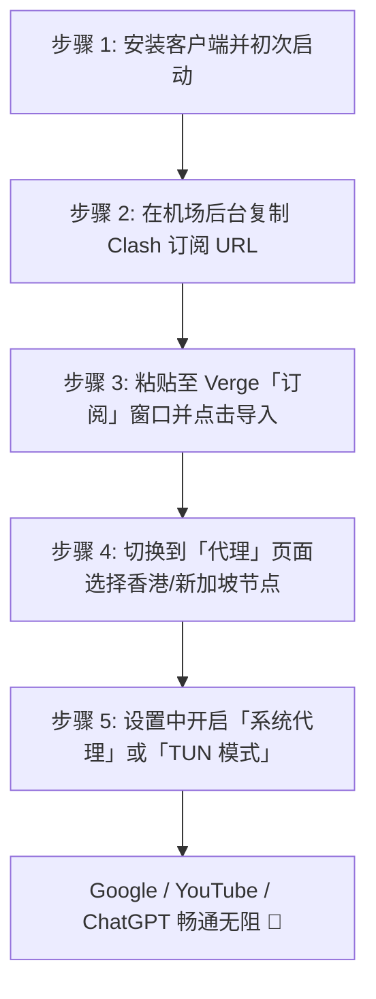

# Clash Verge Rev 电脑客户端配置教程（2026 终极指南）

<SakuraGirl message="Clash for Windows 停更之后，Clash Verge Rev 就是目前桌面端颜值的绝对担当啦！内置新一代 Mihomo (Meta) 内核，TUN 模式还能接管 Steam 联机和终端命令行，学妹带你 3 分钟极速搞定~🌸" />

<StickyNote title="核心导读与防坑警告" emoji="📌">
  <b>Clash Verge Rev</b> 是目前 Windows、macOS 与 Linux 平台首推的开源代理客户端。它彻底解决了老旧客户端内核脆弱、内存泄漏和无法原生支持新一代抗封锁协议的痛点。请务必认准官方 GitHub 开源项目发布地址，切勿在百度搜索引擎前列点击带有广告标识的第三方山寨打包下载站！
</StickyNote>

---

## 一、官方安全下载渠道与版本选型

| 操作系统平台 | 推荐安装包格式 | 适用处理器架构 | 下载通道 |
| :--- | :--- | :--- | :--- |
| **Windows 10/11 (64位)** | `.x64-setup.exe` | Intel / AMD 64位常规电脑 | [GitHub Releases](https://github.com/clash-verge-rev/clash-verge-rev/releases){target="_blank" rel="nofollow noopener"} |
| **Windows 便携免安装版** | `.x64_portable.zip` | 解压即用，不写注册表 | [GitHub Releases](https://github.com/clash-verge-rev/clash-verge-rev/releases){target="_blank" rel="nofollow noopener"} |
| **macOS (Apple Silicon)** | `_aarch64.dmg` | 苹果 M1 / M2 / M3 / M4 芯片电脑 | [GitHub Releases](https://github.com/clash-verge-rev/clash-verge-rev/releases){target="_blank" rel="nofollow noopener"} |
| **macOS (Intel 老款)** | `_x64.dmg` | 苹果 2020 年及以前的 Intel 芯片电脑 | [GitHub Releases](https://github.com/clash-verge-rev/clash-verge-rev/releases){target="_blank" rel="nofollow noopener"} |
| **Linux 桌面版** | `.deb` / `.AppImage` | Ubuntu / Debian / Arch / Fedora | [GitHub Releases](https://github.com/clash-verge-rev/clash-verge-rev/releases){target="_blank" rel="nofollow noopener"} |

---

## 二、从零到一配置实战步骤（图解流程）

### 步骤 1：复制机场订阅链接
登录你所使用的机场（例如本站主推的 [光速云](/brands/guangsu) 或 [飞猫云](/brands/feimao)），进入「用户中心」或「仪表盘」，找到 **“复制 Clash 订阅”** 按钮点击复制。

### 步骤 2：导入订阅至 Clash Verge Rev
1. 打开 Clash Verge Rev 客户端；
2. 点击左侧导航栏的 **「订阅 (Profiles)」**；
3. 在顶部的输入框中粘贴刚才复制的 URL 链接，点击右侧的 **「导入 (Import)」**；
4. 导入成功后，单击选中所导入的配置卡片，使其变为高亮选中状态。

### 步骤 3：选择节点并开启代理
1. 点击左侧导航栏的 **「代理 (Proxies)」**，展开策略组（通常名为 `PROXY` 或 `节点选择`）；
2. 选择延迟较低的绿色节点（如香港 IEPL 01 或新加坡 01）；
3. 点击左侧 **「设置 (Settings)」**，打开 **「系统代理 (System Proxy)」** 开关。

---

## 三、TUN 虚拟网卡模式：为什么极客强烈推荐开启？

常规的“系统代理”仅对支持 HTTP 代理协议的浏览器（Chrome / Edge）生效；而对于 **CMD 终端（Git、curl、npm）、Steam / Epic 游戏客户端、Telegram 桌面版** 等应用，往往无法走代理。

**TUN 模式（虚拟网卡）** 的核心优势：
* **全系统流量接管**：在操作系统内核中虚拟出一块真实网卡，把电脑所有的 TCP / UDP 网络数据包强制纳入 Mihomo 规则分流；
* **如何开启**：进入 Verge「设置」→ 找到「TUN 模式」→ 打开开关。初次开启系统会弹出 UAC 提权提示，点击“是”自动安装 Wintun 驱动即可。

---

## 四、常见报错与避坑排错指南

<b>Q1: 导入订阅提示“Network Error”或“Fetch Profile Failed”？</b>

  <b>答：</b> 说明你的本地网络无法直接连接该机场的订阅服务器。解决方法： 
  1. 如果电脑原本有其他可用梯子，先开启旧梯子后再点导入； 
  2. 联系机场客服确认订阅域名是否遭污染，尝试更换订阅转换节点。

<b>Q2: 节点列表全部显示 Timeout（超时或红点），但网页能打开？</b>

  <b>答：</b> 点击右上角的设置图标，将测速 URL（Test URL）从默认的 `http://www.gstatic.com/generate_204` 修改为 `https://cp.cloudflare.com/generate_204`，重新点击测速即可恢复正常延迟数值。

<b>Q3: 微信/QQ 出现消息延迟，或者国内网站变卡？</b>

  <b>答：</b> 确保代理模式选择的是<b>「规则 (Rule)」</b>模式，而不是「全局 (Global)」模式。在规则模式下，国内网站流量直接走本地宽带直连，海外流量才走机场专线。

---

  

    🌸 客户端配置好了，还没有高速专线节点？推荐查看本站评测推荐榜单： 
    [👉 2026 梯子排行榜](/topics/ranking-guide) | [🥇 光速云万字实测](/brands/guangsu) | [🧪 42 家机场品牌库](/topics/airport-brands)
  

