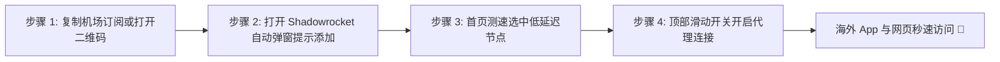

# Shadowrocket（小火箭）iOS 下载与配置教程（2026 全面指南）

<SakuraGirl message="iPhone 和 iPad 用户最常用的就是小火箭（Shadowrocket）啦！虽然名字叫小火箭，但它其实是功能超级强大且极其省电的规则代理神器哦~ 跟着学妹避开国区山寨李鬼软件，轻松上手~🌸" />

<StickyNote title="苹果用户安全第一铁律" emoji="⚠️">
  <b>Shadowrocket 在中国大陆 App Store 已下架</b>。请务必自备<b>海外区（推荐美区）Apple ID</b> 并在 App Store 购买下载（售价约 $2.99）。切勿在国区 App Store 搜索购买名为“小火箭VPN”、“Shadowrocket”的山寨欺诈软件！
</StickyNote>

---

## 一、如何下载正版 Shadowrocket

1. **准备美区 Apple ID**：如果你没有美区账号，可以在网上搜索“美区 Apple ID 注册教程”自行注册，或通过正规渠道获得；
2. **退出国区 App Store**：打开 iPhone 系统的「App Store」，点击右上角个人头像，滑到最底部点击「退出登录」；
3. **登录美区账号**：在 App Store 登录你的美区 Apple ID；
4. **搜索下载**：搜索 `Shadowrocket`，认准开发者名称为 **Shadow Launch Technology Limited**，正版图标为一个在黄色圆圈内的白色航天小火箭，付费 $2.99 完成安装。

---

## 二、机场订阅导入与一键连接

### 方式 A：二维码一键扫码（最简单）
1. 在电脑或另一台设备上登录你的机场后台（例如 [光速云](/brands/guangsu) 或 [微风网络](/brands/weifeng)）；
2. 找到 **“Shadowrocket 订阅二维码”**；
3. 打开手机上的 Shadowrocket，点击左上角的 **「扫描 (Scan)」** 图标扫描屏幕上的二维码，节点将全自动导入。

### 方式 B：复制订阅 URL 手动导入
1. 在手机浏览器复制机场的订阅链接；
2. 打开 Shadowrocket，点击右上角的 **「+」** 号；
3. 「类型」选择 **`Subscribe`**；
4. 在「URL」栏中粘贴刚才复制的链接，在「备注」随便写个名字（如“光速云专线”），点击右上角 **「保存 (Save)」**；
5. 首页即可看到更新出的节点列表。

---

## 三、规则分流与省电设置技巧

* **全局路由选择「配置 (Config)」**：千万不要选「全局代理 (Proxy)」，选「配置」模式时，微信、淘宝、抖音等国内应用自动直连，既省机场流量又大幅降低手机耗电；
* **按应用分流排除**：如果发现某个国产银行 App 提示异地网络异常，可以在 Shadowrocket「配置」中添加一条域名规则（DIRECT 直连）即可。

[👉 返回客户端全平台全景库](/topics/clients-hub) | [🏆 查看 2026 梯子排行榜](/topics/ranking-guide)
