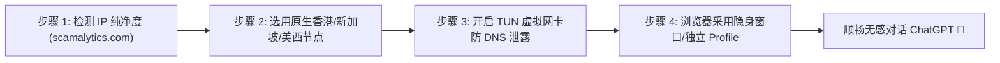

# ChatGPT / Claude / AI 生产力专属专线与防封指南

<StickyNote title="AI 创作者网络痛点" emoji="🤖">
  2026 年是生成式 AI（ChatGPT 4o/o1、Claude 3.5 Sonnet、Midjourney、Cursor）全方位融入生产力的一年。但很多朋友常遇到：<b>“刚充了 20 美元 Plus 账号第二天就被封”、“Claude 提示 Unsupported Country”、“对话频繁弹出 Cloudflare 拼图验证”</b>。 
  这背后的核心原因不是你的账号问题，而是<b>你所使用的梯子节点 IP 被 AI 公司的风控引擎判定为了高危机房代理</b>！
</StickyNote>

---

## 一、OpenAI 与 Anthropic 的核心风控审查维度

主流 AI 平台对网络环境的审查极其严苛，核心依据三大维度：

1. **IP 类型（Type）与 IP 欺诈度（Fraud Score）**
   * AI 公司会实时接入 MaxMind、IP2Location 等风控数据库。如果是来自 DigitalOcean、Vultr、AWS 等云计算数据中心（Data Center）的 IP，欺诈分通常高达 80-100 分；
   * 只有真正的 **原生 ISP 或住宅 IP（Residential IP）**，欺诈分才会在 10 分以下，受到系统高度信任。
2. **同 IP 并发会话数（Concurrency）**
   * 劣质共享机场的一个节点往往挂载了成千上万名用户。几千人共用同一个 IP 不断请求 OpenAI API，OpenAI 防火墙会立刻触发限频或直接将该 IP 整段屏蔽。
3. **WebRTC 与 DNS 泄漏**
   * 即使客户端开启了代理，如果浏览器的 WebRTC 泄漏了你真实的国内电信/联通本地 IP，或者 DNS 请求被劫持到国内运营商 DNS，AI 网站会直接识别出真实地理位置并返回 1020 报错。

---

## 二、2026 AI 生产力专属机场排行榜

根据落地 IP 纯净度、ChatGPT/Claude 可用率及长期稳定性实测：

| 推荐排名 | 品牌名称 | AI 专属优势 | 推荐节点地区 | 评测详情 |
| :---: | :--- | :--- | :--- | :---: |
| 🥇 01 | **光速云** | IEPL 专线直连，提供 ChatGPT 专用解锁通道，零 Cloudflare 弹窗 | 新加坡 01-10、香港原生 | [查看评测](/brands/guangsu) |
| 🥈 02 | **速界** | 25 元档唯一明确主打 AI 工具场景，官方重点优化大模型连接 | 日本、新加坡、美国 | [查看品牌](/topics/airport-brands) |
| 🥉 03 | **一翻云** | 全节点 IEPL 配备原生住宅 IP，Claude 3.5 封控穿透力极强 | 台湾、香港、美国 | [查看品牌](/topics/airport-brands) |
| 04 | **唯兔云** | IPLC 专线，支持 ChatGPT、Gemini、Claude 三大模型无降级直连 | 香港、新加坡 | [查看品牌](/topics/airport-brands) |
| 05 | **Firefly** | IPLC 纯专线，原生 IP 落地，全节点不限速保障长文本流式传输 | 新加坡、日本 | [查看品牌](/topics/airport-brands) |

---

## 三、AI 生产力防封排错 4 步法则

1. **查 IP 纯净度**：访问 `scamalytics.com`，查看当前节点的 Fraud Score（欺诈分数）。若分值高于 40 分，果断在客户端内切换其他节点；
2. **首选低风控落地地区**：
   * **OpenAI ChatGPT**：推荐使用 **新加坡、日本、美国、英国** 节点（注意：香港官方仍不支持，但部分机场通过智能路由重定向至美日落地）；
   * **Anthropic Claude**：推荐使用 **美国、英国、日本** 节点，尽量避开人流密集的常规香港公网节点；
3. **客户端务必开启 TUN 模式**：无论是 [Clash Verge Rev](/topics/clients-hub#windows) 还是 [v2rayN](/topics/clients-hub#windows)，务必开启虚拟网卡 TUN 模式，确保系统内所有 AI 桌面应用（如 Cursor、Windsurf、Copilot）流量均完整被代理接管；
4. **清理 Cookie 或使用独立浏览器 Profile**：每次切换新节点前，使用 Chrome 无痕模式或专门为 AI 工作设立一个独立的浏览器配置文件，防止历史缓存泄露。
