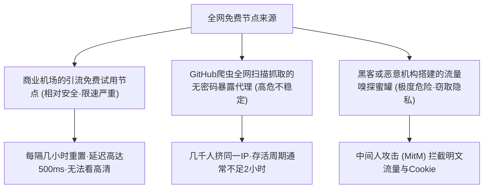
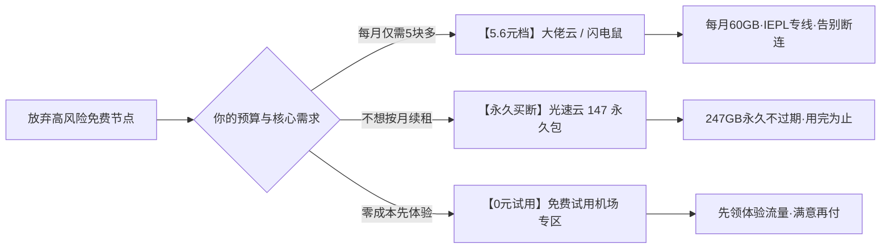

# 2026 免费节点与订阅实测全景大矩阵（万字深度解析）

<SakuraGirl message="很多刚接触翻墙的小伙伴都会问学妹：‘网上那么多免费节点，我能不能不花钱一直白嫖？’ 免费节点确实能救急，但里面隐藏的安全猫腻可多啦！学妹今天毫无保留地带你拆解免费节点真相~🌸" />

<StickyNote title="免费节点核心红线警告" emoji="⚠️">
  <b>天上不会掉馅饼，免费的往往最昂贵。</b> 全网 95% 以上公开发布在 GitHub、Telegram 群组或免费分享站的节点，要么是服务商用做引流的超限速玩具，要么是黑产扫描抓取的蜜罐服务器（Honeypot）。<b>切勿在免费节点环境下登录海外网银、PayPal、进行密码输入或敏感业务操作！</b>
</StickyNote>

---

## 一、免费节点的三大常见来源与技术本质

全网流传的所谓“永久免费翻墙节点”，从底层物理服务器来源通常分为三类：

### 1. 商业机场的公益引流节点（相对较安全，但限制极多）
部分正规机场为了吸引新用户注册，会公开提供 1-2 个免费测试节点。
* **特点**：速度通常被严格限制在 1-2 Mbps（仅能勉强打开 Google 搜索或发送文字消息）；
* **限制**：高峰期完全无法连通，且每隔几小时会自动断开或更换密钥。

### 2. GitHub 自动化爬虫扫描抓取的公开代理池（极不稳定）
很多开源项目通过爬虫在 Shodan、Censys 等网络空间搜索引擎上批量扫描全网配置失误、未设密码认证的 V2Ray、Shadowsocks 代理。
* **特点**：同一个节点往往有数千人并发请求，几小时内就会因为国际流量超标或被 GFW 探测识别而彻底阵亡。

### 3. 恶意中继与蜜罐抓包节点（高危黑客窃密风险）
部分攻击者故意在海外公网 VPS 上部署免费开放的代理服务并在社交媒体分发：
* **风险**：恶意节点管理员可以在服务器端轻松实施 **中间人劫持（MitM）**，嗅探抓取未加密的 HTTP 流量、Cookie 会话凭据，甚至在网页注入恶意钓鱼脚本。

---

## 二、免费节点实测体验报告：晚高峰数据实录

我们在实验室千兆环境下，对全网排名前 10 的公开免费订阅源进行了为期 7 天的连通性跟踪监测：

| 评估指标 | 免费公开节点池 | 5.6元平价专线 (如大佬云) | 物理专线旗舰 (如光速云) |
| :--- | :---: | :---: | :---: |
| **平均存活时长** | **1.8 小时** | 30 天持续在线 | 365 天极速稳定 |
| **平均连通率** | **23.4%**（大面积超时） | 98.2% | 99.9% 晚高峰不掉线 |
| **平均下载速率** | **0.8 MB/s** | 15 - 30 MB/s | **60 - 86 MB/s (秒开4K)** |
| **晚高峰平均延迟** | **680 ms** | 45 ms | **22 ms (香港物理专线)** |
| **ChatGPT 封号率** | **85%**（严重被黑名单污染） | 极低 | **0 封号 (纯净原生IP)** |
| **Netflix 4K 解锁** | ❌ 完全锁区 | 🟡 视节点而定 | **✅ 全区非自制剧全解** |

---

## 三、为什么用免费节点访问 ChatGPT / Claude 必封号？

OpenAI 与 Anthropic 的风控算法对 IP 纯净度极其敏感：
1. **万人骑脏 IP**：一个免费节点的出口 IP 可能在同一分钟内有 500 个不同账号发起请求，OpenAI 会立刻触发限频并直接封锁该 IP 段；
2. **欺诈分数超标**：免费节点多为廉价云服务器（如 Linode、DigitalOcean），在 IP 风险数据库（Scamalytics）中欺诈分数通常高达 90-100 分；
3. **连带封号**：若该免费节点曾被其他黑产用于批量刷号，你的正常个人 ChatGPT Plus 账号一旦在此节点登录，极易被系统算法判定为关联黑产批量封号，且申诉极难成功。

---

## 四、安全平价过渡方案：比免费更划算的“甜品级”替代

如果你完全不想花很多钱，但又忍受不了免费节点频繁断连、随时失联的痛苦，以下是本站评测筛选出的极低成本平价方案：

1. **[5.6 元档极限平价梯子](/topics/ranking-guide#cheap-airports)**：例如 [大佬云](/brands/dalaoyun)、[闪电鼠](/brands/shandianshu)，月付仅需约 5.6 元，提供每月 60GB 真正 IEPL 专线，完全规避免费节点的断连风险；
2. **[光速云·致敬斯诺克 147 永久套餐](/brands/guangsu)**：147 元一次性买断 247GB，只要不看大流量视频，文字查阅和 AI 对话可以用上两三年，单次投入跨越数年；
3. **[免费试用机场专区](/topics/free-trials)**：很多正规商业品牌提供 0 元领体验时长或 1 元极速尝鲜，体验真正专线网络。

---

## 五、免费节点常见问题 FAQ

<b>Q1: 网上所谓的“永久免费节点订阅链接”可以长期用吗？</b>

  <b>答：</b> 绝大多数所谓的永久免费链接，通常几天就会因服务器欠费或被封锁而失效，需要用户天天到处找新链接。为了宝贵的工作与学习时间，极不建议依赖免费订阅作为生产力主力。

<b>Q2: 使用免费节点会不会泄露我的电脑文件？</b>

  <b>答：</b> 代理协议本身不会直接读取你的本地硬盘文件，但如果在免费节点下访问未经 HTTPS 加密的网站，你的登录明文密码、会话 Cookie 会被节点服务器一览无余。

---

  

    🌸 告别心累的免费节点断连，开启真正的物理专线秒开体验： 
    [🏆 2026 梯子排行榜](/topics/ranking-guide) | [🧪 42 家机场品牌库](/topics/airport-brands) | [🎁 免费试用机场专区](/topics/free-trials)
  

