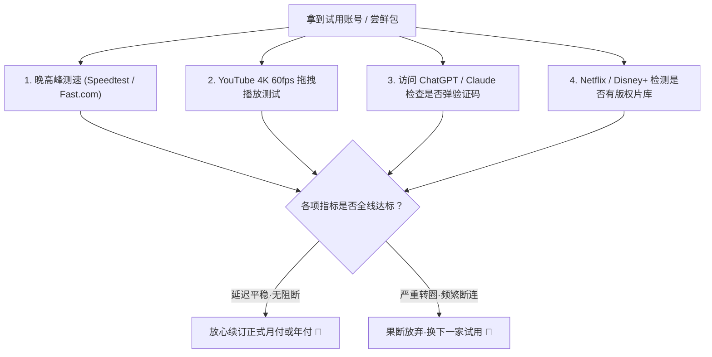

# 免费试用与一元尝鲜机场大矩阵（2026 权威盘点）

<SakuraGirl message="想要知道一家机场到底卡不卡、在你的宽带下能不能跑满千兆？最好的办法绝对不是看广告，而是亲自‘领个试用测一圈’！学妹今天为你盘点那些支持 0 元试用、1 元尝鲜的良心品牌~🌸" />

<StickyNote title="试用选型黄金原则" emoji="🎁">
  <b>永远不要在没有经过本地实际测速的情况下直接购买大额年付套餐。</b> 支持免费试用或 1-2 元低成本试水包的服务商，通常对其服务器带宽与晚高峰抗压能力具有高度自信。先试后买是避免踩坑的最佳护城河！
</StickyNote>

---

## 一、支持免费试用与超低尝鲜门槛的品牌阵容

我们在 42 家机场品牌库中，甄选出具备 **0 元试用机制、极低起步门槛或极低尝鲜成本** 的代表性品牌：

| 品牌名称 | 试用/尝鲜门槛 | 包含资源与政策 | 适用网络环境 | 评测与直达入口 |
| :--- | :--- | :--- | :--- | :---: |
| **飞猫云** | **学生版年付仅 ¥84**（折合约 ¥7/月） | 免配置客户端下载即用，晚高峰实测 86.5MB/s | 电信/联通/移动通用 | [查看评测](/brands/feimao) |
| **无忧链接** | **舒心包月付仅 ¥19** / 年付 ¥79 | 全线不限速不限设备，TikTok 跨境专属优化 | 跨境电商与轻办公 | [查看品牌](/topics/airport-brands) |
| **大佬云** | **月均折算仅 ¥5.6/月** | IEPL 专线，季付即可享受 7 折，极低试水开销 | 文字查阅与低频 AI | [查看评测](/brands/dalaoyun) |
| **闪电鼠** | **月均折算约 ¥5.6/月** | IEPL 专线 + VLESS 协议，超低成本备用 | 学生党与查资料 | [查看评测](/brands/shandianshu) |
| **光速云** | **月付极速版 ¥25** (168GB) | IEPL 双专线，单节点 2.5Gbps，实测香港 22ms 满速 | 4K 追剧与 AI 办公 | [查看评测](/brands/guangsu) |
| **神行加速** | **新用户专享 7 折** | 120GB 翻倍流量，月均仅约 ¥14 | 进阶中度办公需求 | [查看评测](/brands/shenxing) |

---

## 二、0 元试用与小额尝鲜时，重点测什么？（测试清单）

在拿到试用账号或月付尝鲜小包后，千万别只看一眼网页就完事。学妹建议在 **晚上 20:30 - 22:30 的极端晚高峰** 重点核验以下 4 个关键指标：

1. **晚高峰丢包与下行速率**：
   * 打开 `fast.com` 或 `speedtest.net`，测试香港、新加坡核心节点的下行带宽是否能稳定在 100Mbps 以上；
2. **YouTube 4K 拖拽缓冲时间**：
   * 在 YouTube 搜索“4K 60fps HDR”，右键打开“详细统计信息 (Stats for nerds)”，观察 Connection Speed 是否大于 50,000 Kbps，快进 5 分钟后是否在 1 秒内秒开；
3. **AI 纯净度检测**：
   * 打开 `chatgpt.com`，发送 3 段长文本，观察是否频繁触发 Cloudflare 拼图验证；
4. **Netflix 原生片库识别**：
   * 在 Netflix 中搜索周星驰的电影或《绝命毒师》，如果只能搜到自制剧，说明该节点并未原生解锁该地区。

---

## 三、为什么部分高阶物理专线机场（如光速云）不提供免费试用？

经常有用户好奇：“既然光速云那么强，为什么不给 0 元试用，最低要买 25 元的极速版月付？”

* **防羊毛党滥用**：物理 IEPL 专线带宽（每 Gbps 每月成本高达数万元）极其昂贵。一旦开放纯 0 元免认证试用，就会被黑客爬虫和羊毛党批量刷爆，导致正规付费用户的晚高峰带宽被严重挤占；
* **门槛保障稳定性**：设立适度的小额门槛（如 25 元月付，或提供 147 永久套餐），能够有效阻隔垃圾流量，把最高质量的物理专线资源留给真正有长期需求的用户。

---

  

    🌸 测速满意再升级，先从小额月付或低门槛方案开始： 
    [🏆 2026 梯子排行榜](/topics/ranking-guide) | [🧪 42 家机场品牌库](/topics/airport-brands) | [🥇 光速云深度评测](/brands/guangsu)
  

