# 翻墙协议原理与专线网络科普（极客技术解析）

<StickyNote title="极客学妹的网络硬核黑板报" emoji="🔬">
  很多人经常看到机场宣传<b>“IEPL物理专线”、“VLESS-Reality协议”、“晚高峰不丢包”</b>，但并不清楚这到底意味着什么。本篇支柱科普将剥离一切商业包装，带你从底层物理光纤与网络数据包结构，看懂现代科学上网的核心技术命门！
</StickyNote>

---

## 一、物理专线网络：IPLC 与 IEPL 的本质区别

科学上网的物理传输通道主要分为三大等级：**公网直连 → BGP 隧道中转 → 跨境物理专线（IPLC / IEPL）**。

```mermaid
flowchart TD
    subgraph Level1 ["公网直连 (最脆弱)"]
        User1["用户设备"] --> PublicGFW["国内公网 → 穿越 GFW 防火墙 → 海外公网"]
        PublicGFW --> Node1["落地 VPS (极易阻断/被QoS限速)"]
    end
    
    subgraph Level2 ["BGP 隧道中转 (性价比)"]
        User2["用户设备"] --> BGPIn["国内上海/广州 BGP 入口 (TLS加密隧道)"]
        BGPIn --> PublicSea["公网跨境海缆 (仍受国际出口拥堵影响)"]
        PublicSea --> Node2["海外机房"]
    end
    
    subgraph Level3 ["物理专线 IPLC / IEPL (顶级稳定)"]
        User3["用户设备"] --> LineIn["国内专线机房 (点对点物理光缆内网直连)"]
        LineIn --> UnderseaFiber["海底/陆地内网裸纤 (不经过 GFW 防火墙)"]
        UnderseaFiber --> Node3["海外专线落地机房 (晚高峰 0 丢包)"]
    end
```



### 1. IPLC（International Private Leased Circuit，国际私有租用线路）
* **定义**：两端机房之间直接拉设一条端到端的纯内网点对点通信线路；
* **物理特征**：基于传统的 SDH / SONET 传输网，数据在物理层封装传输，**完全不经过中国公网国际互联网网关（GFW）**；
* **优势**：绝对不受敏感时期公网封锁影响，物理延迟极低且极度恒定。

### 2. IEPL（International Ethernet Private Line，国际以太网专线）
* **定义**：基于现代以太网（Ethernet over SDH/OTN）协议架构的高阶专线产品；
* **对比 IPLC**：IEPL 在保留 IPLC“不经过 GFW、物理内网隔离”核心优势的同时，具备更加灵活的带宽调度能力与更现代的以太网接口支持；
* **行业实践**：如 [光速云](/brands/guangsu) 等老牌机场采用的即为 IEPL 专线与企业内网热备机制。

---

## 二、翻墙协议演进史：从 Shadowsocks 到 VLESS Reality 与 Hysteria 2

```
协议演进路线：
SS/SSR (特征明显易识别) → VMess (引入复杂头部，但易被探测) → Trojan (伪装成HTTPS) → VLESS Reality (借用真实大厂证书) → Hysteria 2 (UDP暴力抗丢包)
```

### 1. VLESS 与 Reality 协议机制
传统 Trojan 伪装成 HTTPS 网站，要求机场主必须自己购买海外域名并申请免费 Let's Encrypt 证书。GFW 爬虫可以通过批量扫描证书颁发机构（CA）与 SNI 域名来反向定位梯子节点。

**VLESS Reality** 的革命性在于：
* **“借鸡生蛋”**：它直接借用海外知名大厂的真实合法 TLS 证书（例如苹果 Apple、微软 Microsoft、雅虎等）；
* **主动探测防御**：如果 GFW 防火墙尝试直接向节点端口发送扫描探测包，节点会原封不动地将真实大厂网站的内容代理返回给 GFW，使得防火墙完全无法判断该服务器是否为翻墙节点。

### 2. Hysteria 2（基于 QUIC / UDP 暴力抗高丢包）
在传统的 TCP 协议下，只要国际海缆发生 5% 的丢包，TCP 的拥塞控制算法就会强制让传输速率断崖式下跌 50% 以上。

**Hysteria 2** 彻底摒弃了 TCP，基于 Google QUIC（UDP）深度重构：
* **Brutal 拥塞控制**：哪怕网络丢包率高达 20% - 30%，Hysteria 2 依然能以恒定速率持续喷发数据包，在恶劣弱网、校园网或海外极端距离下依然能拉满带宽。

---

## 三、网络落地属性：原生 IP vs 机房 IP 辨析

| IP 属性类别 | 典型来源 | 适用场景 | ChatGPT / Claude 风控识别 | Netflix 流媒体解锁 |
| :--- | :--- | :--- | :---: | :---: |
| **原生机房 IP** | 机房广播原生归属本地区 | 适合常规网页浏览与查资料 | 容易触发验证码 | 支持原创剧全解锁 |
| **广播/机房中转 IP** | 跨区 BGP 广播宣布 | 成本极低，廉价机场常用 | 极易被直接拒绝访问 | 仅能看自制剧（锁区） |
| **原生住宅 IP（Residential）** | 海外本地家庭宽带 ISP 分配 | 跨境电商养号、AI 深度交互 | **完美零风控信任度** | **全区所有非自制剧全通** |

*代表方案*：如 [一翻云](/topics/airport-brands) 配备的原生住宅 IP，就是专为规避海外严格风控而生的高级资源。
