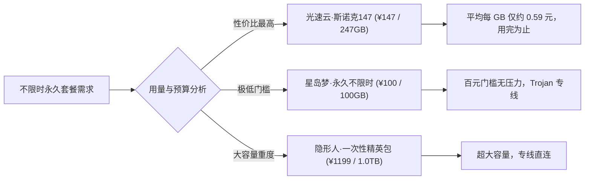
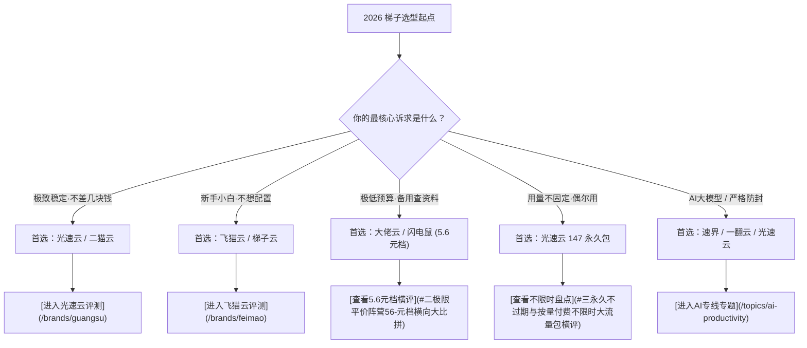

# 2026 稳定梯子推荐与机场红黑榜（万字权威指南）

<StickyNote title="红黑榜选型核心导言" emoji="🏆">
  市面上的机场服务商成百上千，但 80% 的新手用户都踩过这几个坑：<b>刚充大额年付两周就跑路、晚高峰 8 点准时卡成幻灯片、虚标 10 倍率暗扣流量、IP 频繁被 ChatGPT 与 Netflix 拉黑</b>。 
  赔钱博客评测团队历时数月，对 42 家主流品牌进行了多轮千兆晚高峰压测与协议逆向，提炼出这份涵盖<b>红榜优选、黑榜避坑、平价横评与不限时盘点</b>的权威选型知识图谱。
</StickyNote>

---

## 一、2026 年度梯子推荐总红榜（前 10 梯队）

综合 **线路抗封锁能力（物理专线 vs 公网中转）**、**晚高峰丢包率与测速**、**运营年限及跑路风险**，我们评定出 2026 年最具购买价值的红榜阵营：

| 综合排名 | 品牌名称 | 核心线路架构 | 起步门槛 | 核心亮点与推荐理由 | 实测评测详情 |
| :---: | :--- | :--- | :--- | :--- | :---: |
| 🥇 01 | **光速云** | IEPL 双物理专线 | ¥8/月 (年付¥99) | 2020 老牌，香港 22ms/529Mbps，独创 147 永久套餐 | [深度评测](/brands/guangsu) |
| 🥈 02 | **暮光加速** | BGP 智能调度 | ¥9/月起 | 7×24 小时真人客服，不限设备，多流量档位 | [深度评测](/brands/muguang) |
| 🥉 03 | **飞猫云** | 轻快优化专线 | ¥7/月 (年付¥84) | 官方 App 开箱即用，免配置订阅，实测 86.5MB/s | [深度评测](/brands/feimao) |
| 04 | **微风网络** | IEPL 专线 + VLESS | ¥7/月 (年付¥137) | 原生 IP 节点，流媒体与 AI 解锁稳定，性价比高 | [深度评测](/brands/weifeng) |
| 05 | **星岛梦** | IEPL 专线 Trojan | ¥8/月 (年付¥96) | 2020 老牌，1 倍率不限设备，支持 1TB 永久包 | [品牌详情](/topics/airport-brands) |
| 06 | **二猫云** | IEPL 纯专线 | ¥20/月 (130GB) | 拒绝低价走量，主打长期稳定，自研+通用双支持 | [品牌详情](/topics/airport-brands) |
| 07 | **无忧链接** | 优化中转专线 | ¥6.5/月起 | TikTok 跨境电商直连优化，全线不限速不限设备 | [品牌详情](/topics/airport-brands) |
| 08 | **唯兔云** | IPLC 专线 Trojan | ¥14.9/月 (100GB) | 1 倍率不限速，ChatGPT/Claude/Gemini 全解锁 | [品牌详情](/topics/airport-brands) |
| 09 | **Firefly** | IPLC 专线 VLESS | ¥8/月 (年付¥96) | 原生 IP，全节点不限速，骨干网接入晚高峰稳定 | [品牌详情](/topics/airport-brands) |
| 10 | **一翻云** | IEPL + 原生住宅 IP | ¥8.2/月 (年付¥98) | 稀缺原生住宅 IP，豪华支持 Hysteria 2 / Reality | [品牌详情](/topics/airport-brands) |

---

## 二、极限平价阵营：5.6 元档横向大比拼

在 42 家清单中，有一批以 **“年付折算约 5.6 元/月、每月提供 60GB 流量”** 为特征的极度平价品牌：**大佬云、闪电鼠、云界线、榴莲云、环球梯**。

### 1. 5.6 元档横向对比全景表
| 品牌 | 线路宣称 | 核心协议 | 月流量 | 客户端适配 | 价格策略 | 购买建议与注意事项 |
| :--- | :--- | :--- | :--- | :--- | :--- | :--- |
| **大佬云** | IEPL 专线 | VLESS | 60GB | 自研 + 通用订阅 | 季付以上 7 折 | 规范度较好，适合文字查阅与低频 AI |
| **闪电鼠** | IEPL 专线 | VLESS | 60GB | 自研 + 通用订阅 | 季付以上 7 折 | 协议明确标注 VLESS，备用首选 |
| **云界线** | IEPL 专线 | VLESS | 60GB | 自研 + 通用订阅 | 季付以上 7 折 | 推广链接缺少 #，注册需核验页面 |
| **榴莲云** | IEPL 专线 | 未明确标注 | 60GB | 自研 + 通用订阅 | 季付以上 7 折 | 协议未统一标注，建议首选闪电鼠 |
| **环球梯** | IEPL 专线 | VLESS | 60GB | 自研 + 通用订阅 | 季付以上 7 折 | 链接格式异常，适合低成本防失联 |

### 2. 5.6 元档到底能不能当主力梯子？
* **适合做什么**：查阅维基百科与 Google 英文学术文献、使用文字版 ChatGPT 翻译和改写、作为备用梯子防失联；
* **不适合做什么**：高频刷 YouTube 4K、追剧 Netflix、下载海外网盘大文件。60GB 的月流量在 4K 视频下大约只能支撑 8-12 小时。

---

## 三、永久不过期与按量付费不限时大流量包横评

对于差旅人士、留学生回国探亲或偶尔查资料的低频用户，“按月订阅”会造成极大的流量浪费。以下是支持 **“一次性付费、流量永不清零”** 的优质品牌对比：

* **🥇 最佳性价比推荐：光速云·致敬斯诺克 147 永久套餐**
  * **价格**：¥147 一次性买断
  * **流量**：247GB 永久不过期
  * **线路**：全线 IEPL 专线 + 原生稳定节点，享受与月付高阶用户完全一致的单节点 2.5Gbps 带宽与晚高峰保障。
* **星岛梦·永久不限时包**：提供 100GB（¥100）、300GB（¥300）、1TB（¥600）三个档位，Trojan 协议，1 倍率不限设备。
* **二猫云·不限时套餐**：¥99 包含 100GB 专线流量，全线 IEPL，适合备用。

---

## 四、黑榜避坑与跑路高危机场特征深度排查

为了保障资金安全，极客学妹整理出 4 条高危机场识别铁律：

### 1. 超低价终身套餐（Lifetime Subscription）陷阱
> ⚠️ **警告**：宣称“99 元终身无限流量”、“199 元永久无限用”的机场，99.9% 是蓄意跑路盘。物理专线与国际带宽属于持续性高额成本（专线千兆月租数万元），没有任何正常的商业实体能够承受无限终身免费服务，通常运营 2-3 个月资金链断裂即关站跑路。

### 2. 虚标 10 倍率暗扣流量
部分不良机场首页标榜月费只要 5 元给 500GB，但用户连接后发现所有香港、日本常用优质节点都被打上了 `10x` 或 `15x` 的高倍率标签。这意味着你实际下载 1GB 视频，系统后台会扣除 10GB 流量，原本宣称的 500GB 实际只有 50GB，属于典型的虚假营销。

### 3. 公网直连无任何中转伪装
如果一个机场的所有节点都是廉价公网 VPS 直连（无 BGP 隧道、无 IEPL 专线、无 Reality 伪装），只要遭遇敏感时期的大规模探测，几小时内全站节点就会全军覆没。

---

## 五、2026 梯子综合选型决策树

---

## 六、🗺️ 专题 A 蜂巢知识图谱：10 大三级内容集群规划

为了让出海极客与新手全面掌握选型逻辑，本专题构建了以下 10 个独立深入的三级内容集群与蜂巢内链体系：

<b>1. 晚高峰零丢包专线梯子选型集群</b>

  涵盖核心长尾问答：晚高峰 20:00-23:00 为什么梯子必卡、海缆 QOS 调度原理、物理裸纤 vs 隧道中转丢包率实测对比、香港与新加坡近端节点选型、单节点 2Gbps 带宽真实可用率等。核心对应主推品牌：<a href="/brands/guangsu">光速云</a> 与 <a href="/brands/muguang">暮光加速</a>。

<b>2. 极客与开发者专属高速节点集群</b>

  涵盖技术长尾：Git clone 速度拉满配置、Docker hub 镜像拉取加速、npm/pip 依赖安装代理配置、Linux 命令行代理导出、AWS/GCP 控制台稳定访问等。

<b>3. 极致性价比与平价轻量机场实测集群</b>

  涵盖 5.6 元档（大佬云、闪电鼠、云界线、环球梯）横向深度评测、7 元档微风网络与飞猫云学生版评测、月费 10 元以内梯子避坑指南。

<b>4. 不限时按量付费永久大流量包集群</b>

  包含光速云 147 永久套餐、星岛梦永久不限时包、二猫云 ¥99 备用包等方案的单 GB 成本测算与防过期攻略。

<b>5. 多设备与全家桶共享机场推荐集群</b>

  探讨不限制设备连接数（No Connection Limit）的物理实现、宿舍/小团队/全家人合租防风控技巧、暮光加速与灵猫网络多端实测。

<b>6. 外贸跨境电商专用低风控专线集群</b>

  涵盖 Shopify 独立站多店铺防关联登录、Amazon 卖家后台防封号网络设置、PayPal 提现风控规避与住宅 IP 选用策略。

<b>7. 游戏低延迟加速专线节点评测集群</b>

  针对 Steam、PS5、Nintendo Switch 联机 NAT 类型优化、全节点 UDP Full Cone 转发测试、亚服 30ms 极低延迟选点。

<b>8. 运营 3 年以上老牌长寿机场深度调研集群</b>

  调研 2020 年运营至今的光速云、星岛梦、青云梯等老牌团队的机房架构与抗波动周期历史记录。

<b>9. 避坑指南：跑路高危机场特征识别集群</b>

  拆解低价终身无限流量盘跑路套路、虚标 10-15 倍率暗扣流量手法、全公网廉价 VPS 直连的脆弱性分析。

<b>10. 42 家机场综合横向对比打分体系集群</b>

  汇总全站 42 家机场品牌规格横评体系，直达 <a href="/topics/airport-brands">42家机场品牌库总览</a>。

