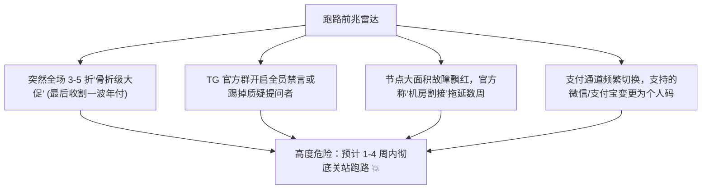
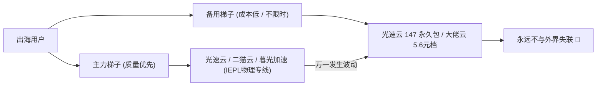

# 机场跑路预警与避坑红黑榜大矩阵（万字深度指南）

<SakuraGirl message="许多翻墙朋友最痛心疾首的经历就是：‘刚买的大额年付，两周后官网直接打不开了，TG 群也全员禁言解散了！’ 机场为什么老是跑路？跑路前有哪些征兆？学妹今天教你练就一双火眼金睛，彻底守住你的钱包~🌸" />

<StickyNote title="跑路预警核心防御准则" emoji="🚨">
  <b>机场本质上是高流动的灰产服务，没有任何一家机场能保证 100% 永不关闭。</b> 我们能做的就是：<b>绝不贪小便宜购买终身套餐、优先按月/按季支付、常备一条不同线路架构的低成本备用防失联通道（如 5.6 元档或永久不过期包）</b>。
</StickyNote>

---

## 一、高危跑路机场的四大典型征兆（跑路前兆排查）

根据近 3 年全网跑路关站的数百家机场样本逆向分析，商家在卷款跑路前通常会出现以下 **4 项异常动作**：

### 1. 突发异常的“全场骨折大促销”
平时不温不火的机场，突然毫无节假日由头发起“年付 3 折”、“买一年送一年”、“99 元终身无限流量”等极其夸张的活动。这通常是商家资金链断裂或准备彻底撤场前的**最后一轮割韭菜圈钱**。

### 2. 官方 Telegram 群组禁言或关闭工单
正常的商业机场会保持公开的交流群或工单系统。一旦发现官方群被设为“全员禁言”，或者工单提交后数天无人回复，说明运营团队已被迫离场或已开始摆烂。

### 3. 节点大面积故障，以“机房升级/被攻击”为由拖延
核心专线全部超时，客服公告却一再声称“被同行 CC 攻击”、“主干机房物理割接正在恢复中”，如果超过 7-10 天依然没有任何好转迹象，基本可以判定为商家欠费弃盘。

### 4. 支付渠道频繁变更与个人转账
原本正常的第三方支付通道消失，转为个人微信赞赏码、私信发红包或频繁更换高风险支付接口，说明其正规资金账户已被风控冻结。

---

## 二、黑名单特征：千万别碰的三类致命陷阱

| 陷阱类型 | 商家宣传口号 | 真实内幕与风险 | 踩坑指数 |
| :--- | :--- | :--- | :---: |
| **超低价“终身套餐”** | “¥99 终身无限用 / 永久免费提速” | 纯诈骗套路，通常存活 1-3 个月直接关服跑路 | ☠️☠️☠️☠️☠️ |
| **虚假高倍率扣费** | “月付 5 元给 1TB 超大流量” | 节点全标 10x-20x 倍率，实际只能用 50GB | ☠️☠️☠️☠️ |
| **纯公网廉价直连** | “千兆独享原生带宽” | 无物理专线，敏感时期几小时内全节点阵亡 | ☠️☠️☠️ |

---

## 三、资金安全防护与止损防失联应急预案

为了防止主力机场突发故障导致海外业务、学术资料全面瘫痪，极客学妹建议建立 **“1 主 + 1 备” 双梯子防失联体系**：

1. **坚持月付或小额季度付原则**：新开业不足 1 年的新品牌，无论宣传多么诱人，严禁直接充值数百元大额年付；
2. **常备永久不过期流量包**：如 [光速云·斯诺克147永久套餐](/brands/guangsu)（147元买断 247GB 永不过期），平时放着不扣钱，一旦主力机场故障，随时切换使用；
3. **选型参考运营年限**：优先选择运营时间长达 3 年以上、拥有独立专线机房资产的老牌商家（详见 [42 家机场品牌库](/topics/airport-brands)）。

---

  

    🌸 远离跑路高危盘，选择经过长期实测核验的可靠专线： 
    [🏆 2026 梯子排行榜](/topics/ranking-guide) | [🧪 42 家机场品牌库](/topics/airport-brands) | [🎁 免费试用机场专区](/topics/free-trials)
  

