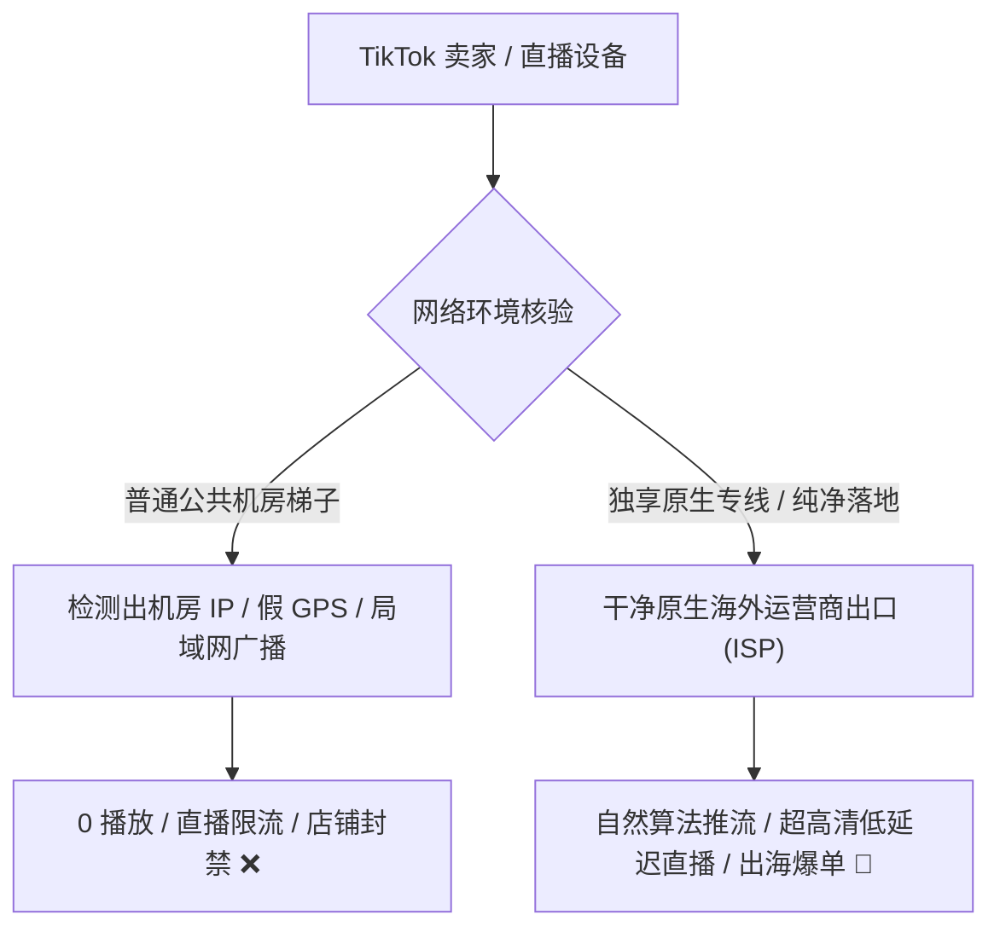

# 4K 流媒体与跨境出海运营生态实战指南

<StickyNote title="极客学妹的追剧与出海提示" emoji="🎬">
  在科学上网的日常应用中，<b>“看剧（Netflix / Disney+ / YouTube）”</b> 与 <b>“赚钱（TikTok 出海直播 / Shopify 跨境独立站）”</b> 是消耗带宽与对 IP 质量要求最高的两大领域。 
  普通中转梯子看 1080P 勉强够用，但一碰到 4K 蓝光 HDR 就会频繁转圈缓冲；而 TikTok 直播如果用了机房垃圾 IP，不仅进直播间没流量（0 播放），还可能导致店铺资金冻结。
</StickyNote>

---

## 一、Netflix 奈飞非自制剧全区解锁底层逻辑

很多新手经常纳闷：“为什么我能看《怪奇物语》，却搜不到周星驰的电影或《绝命毒师》？”

### 奈飞的两种封锁形态：
1. **仅能看 Netflix 自制剧（半解锁 / 被屏蔽）**：
   * Netflix 拥有全球版权的剧集（Originals）通常向所有 IP 开放；但如果 Netflix 判定你的节点是机房代理，它会**静默屏蔽所有非自制购买版权的电影**；
2. **全区非自制剧解锁（真正原生解锁）**：
   * 只有当节点的落地 IP 被 Netflix 识别为海外当地合法住宅或原生合规出口时，你才能解锁该地区的完整片库（例如香港片库、日本动画全集、台湾本土剧）。

---

## 二、TikTok 跨境电商与海外直播专线要求

TikTok 的风控算法属于全球顶流，针对跨境电商卖家设立了多重围栏：

### 跨境电商三大严苛要求：
1. **原生独享或高纯净度 IP**：严禁频繁变动 IP 归属地，防止 Shopify 或 Amazon 店铺触发“异地高危盗刷登录”防关联风控；
2. **上行带宽不设卡（Upstream Bandwidth）**：常规看视频主要依赖下行速度，但 **TikTok 手机直播推流需要至少 10-20 Mbps 极其稳定的上行带宽**，普通中转梯子往往限制了上行，导致直播频繁卡顿掉帧；
3. **低抖动专线直连**：必须选用如 [光速云定制版](/brands/guangsu) 或 [无忧链接跨境优化包](/topics/airport-brands) 等针对电商出海的专线网络。

---

## 三、2026 流媒体与出海优选机场阵容

| 推荐品牌 | 核心优势 | 流媒体解锁表现 | 跨境电商适应性 | 快速直达 |
| :--- | :--- | :--- | :--- | :---: |
| **光速云** | IEPL 双专线，单节点最高 2.5Gbps 带宽，晚高峰 4K 拖拽秒开 | Netflix、Disney+、HBO 原生全解 | 极佳（支持定制独立原生 IP） | [进入评测](/brands/guangsu) |
| **飞猫云** | 晚高峰实测 86.5 MB/s（526Mbps），专属 App 免配置 | YouTube 4K/8K 码率稳定拉满 | 良好（适合日常选品调研） | [进入评测](/brands/feimao) |
| **无忧链接** | 针对跨境电商和 TikTok 跨区直连调优，全线不限速不限设备 | 支持主流流媒体日常追剧 | 特色主打 TikTok 跨区运营 | [查看品牌](/topics/airport-brands) |
| **一翻云** | 原生住宅 IP 落地，晚高峰丢包趋近于 0 | 全区非自制剧全通 | 极高（住宅 IP 极其稀缺） | [查看品牌](/topics/airport-brands) |
| **唯兔云** | IPLC 专线 Trojan 协议，1 倍率全节点不限速 | Disney+、Netflix、YouTube Premium | 适合中小型外贸工作室协同 | [查看品牌](/topics/airport-brands) |
